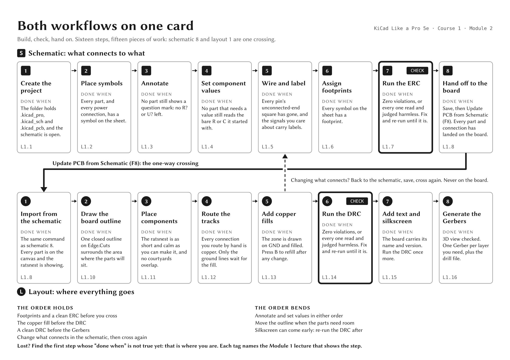

# The sixteen steps

The whole PCB workflow from Course 1 on one card: eight schematic steps, the one-way
crossing to the board, and eight layout steps. Each step says when it is done, and its tag
names the Module 1 lecture that shows it. It matches the quick reference in Chapter 5 of
*KiCad Like a Pro, 5th Edition*, Volume 1.

- [`sixteen-steps-card.png`](sixteen-steps-card.png): the card as an image.
- [`sixteen-steps-card.pdf`](sixteen-steps-card.pdf): the same card as one A4 landscape page, for printing.

If you get lost partway through a design, find the first step whose "done when" is not true
yet. That is where you are.
